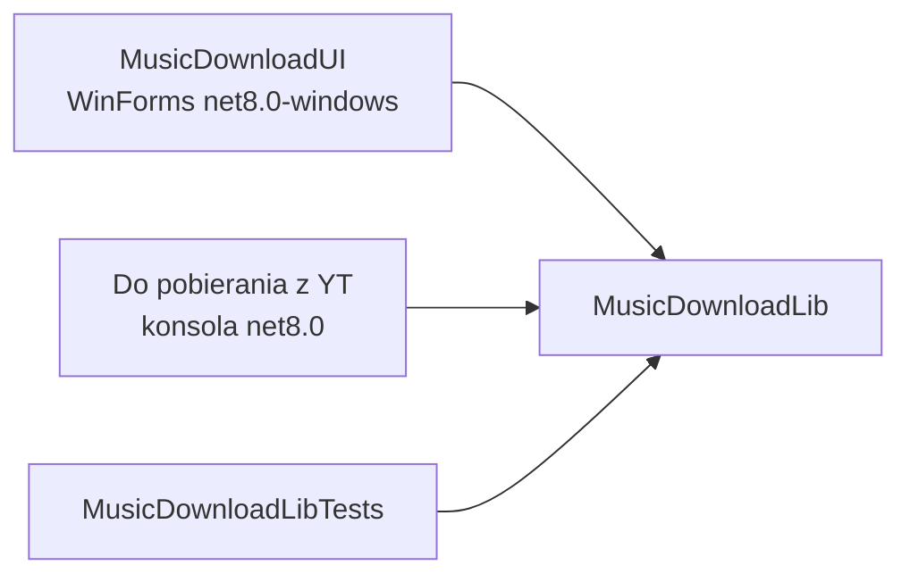
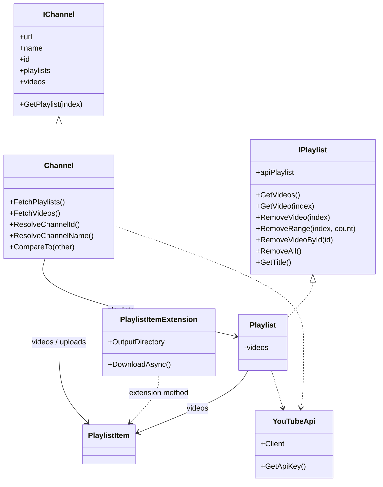
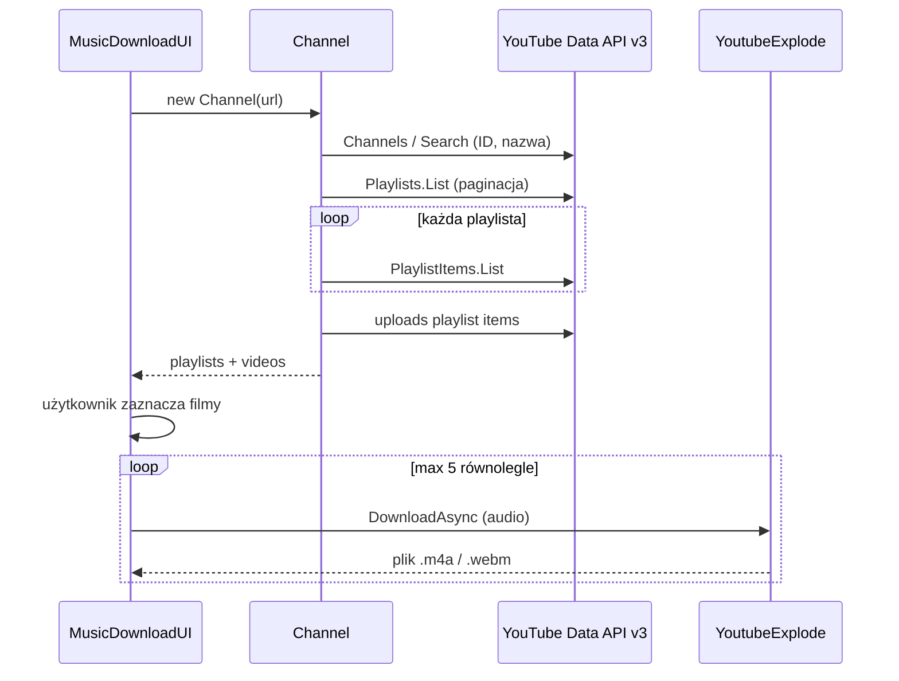

# Architektura — Do pobierania z YT

Aplikacja .NET 8 do przeglądania kanału YouTube (playlisty i filmy) oraz pobierania **audio**. Logika siedzi w bibliotece; na wierzchu są dwa fronty: WinForms i konsola.

## Mapa solution

```
Do pobierania z YT.sln
├── MusicDownloadLib          biblioteka (YouTube Data API + YoutubeExplode)
├── MusicDownloadUI           WinForms — główny interfejs
├── Do pobierania z YT        konsola — listowanie kanału
└── MusicDownloadLibTests     MSTest
```

Zależności:



UI i testy referencjonują bibliotekę wprost. Konsola nie jest warstwą pośrednią.

## Warstwy

| Warstwa | Projekt | Odpowiedzialność |
|---|---|---|
| Prezentacja | `MusicDownloadUI` | URL kanału, lista playlist, miniatury, filtr, zaznaczanie, postęp, folder zapisu |
| CLI | `Do pobierania z YT` | Wypisanie uploadów i playlist (bez pobierania) |
| Domena / integracja | `MusicDownloadLib` | Rozpoznanie kanału, playlisty, filmy, pobranie audio |
| Testy | `MusicDownloadLibTests` | Jednostkowe (playlisty) i integracyjne (żywe API kanału) |

Biblioteka celuje w `net8.0`, UI w `net8.0-windows` (Windows Forms).

## Model w `MusicDownloadLib`



- `Channel` — po URL-u rozwiązuje ID i nazwę, potem ładuje playlisty kanału i listę uploadów.
- `Playlist` — opakowuje `Google.Apis.YouTube.v3.Data.Playlist` i dociąga pozycje (paginacja, max 50 na stronę).
- Filmy to `PlaylistItem` z API Google, nie własny typ.
- `PlaylistItem.DownloadAsync()` — pobiera najlepszy strumień audio (YoutubeExplode) do `OutputDirectory`.
- `YouTubeApi` — jeden współdzielony `YouTubeService` i odczyt klucza API.
- `Channel` implementuje `IComparable<Channel>` i porównuje po nazwie (ignorując wielkość liter).

Konstruktor `Channel` jest synchroniczny i od razu woła sieć. UI owija to w `Task.Run`, żeby nie zablokować okna.

## Przepływ danych



Dwie role API:

1. **YouTube Data API v3** (`Google.Apis.YouTube.v3`) — metadane: kanał, playlisty, tytuły, miniatury.
2. **YoutubeExplode** — faktyczne pobranie strumienia audio.

ComboBox jakości w UI (Audio only / 720p / 1080p) jest na razie tylko atrapą; pobieranie zawsze ściąga audio.

## Rozpoznawanie kanału

`Channel.ResolveChannelId()` obsługuje:

| Wejście | Sposób |
|---|---|
| ID `UC…` | użycie wprost |
| `youtube.com/channel/UCxxx` | wycinek ścieżki |
| `@handle` lub `/@handle` | `Channels.List` + `ForHandle` |
| `/user/nazwa` | `ForUsername` |
| `/c/nazwa` | wyszukiwanie |
| inny tekst / URL | `Search.List` typu `channel` |

Nazwa kanału idzie z `Channels.List("snippet")`, nie z Search.

## UI (`MusicDownloadUI`)

Główny ekran to `Form1`:

- pole URL + **Refresh** (Enter też ładuje kanał),
- **Show All** — filmy ze wszystkich playlist,
- lista playlist po lewej, `ListView` z miniaturami po prawej,
- filtr tytułów, **Select All**, **Download** (tylko zaznaczone),
- **Folder** — katalog zapisu (domyślnie `Muzyka\YouTube Downloads`),
- pasek postępu i log na dole.

Start: po `Shown` ładuje domyślny URL (`https://www.youtube.com/@NFmusic`) w tle.

## Konsola

`Do pobierania z YT/Program.cs` tworzy `Channel` ze stałego URL-a, wypisuje uploady i playlisty i kończy pracę. Nie pobiera plików.

## Konfiguracja

Klucz YouTube Data API **nie jest w kodzie**. Kolejność szukania:

1. zmienna środowiskowa `YOUTUBE_API_KEY`
2. plik `youtube-api-key.txt` — od katalogu binarki / CWD w górę, aż do folderu solution

`youtube-api-key.txt` jest w `.gitignore`.

Katalog zapisu: `PlaylistItemExtension.OutputDirectory` (UI może go zmienić przyciskiem Folder).

## Testy

| Klasa | Charakter | Uwagi |
|---|---|---|
| `PlaylistTests` | jednostkowe, in-memory | konstruktor `Playlist(List<PlaylistItem>)` bez sieci |
| `ChannelTests` | integracyjne | żywe YouTube Data API i klucz |

Runner: MSTest (`EnableMSTestRunner`).

## Stack

- .NET 8 / C#
- `Google.Apis.YouTube.v3` 1.70.x
- `YoutubeExplode` 6.5.x
- Windows Forms
- MSTest 3.6
